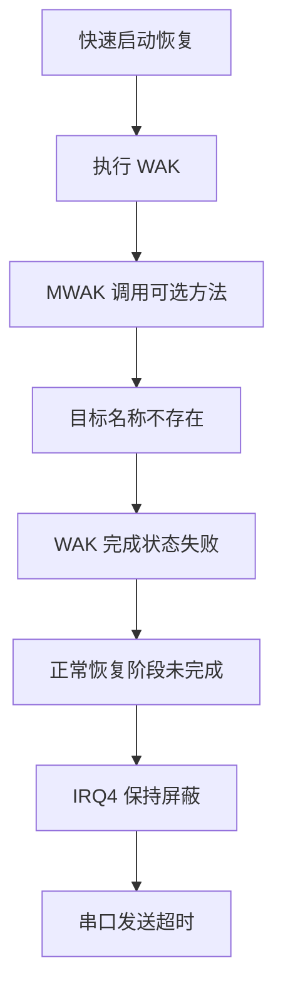

# IT8772E COM 快速启动故障定位与解决记录

[原始 Page](https://chatgpt.com/space/page_686d98454ac48191bacdf61423551f59) · [[40-调试与项目/调试方法/IT8772E COM 故障调试知识与 WinDbg 命令解析.md|配套命令解析]]

结案日期：2026-11-04。项目：ITX-FP5C_V1.1，工作区 `F:\1AVSZ015`，验证 ROM：`IXFP5C06.rom`。

**结果：新 ROM 刷写后，快速启动复现路径的串口测试 PASS；调试器确认 `_WAK` 自然成功完成，Windows HAL 自动恢复 IRQ4。** 本次交付采用用户选定的 workaround：跳过不存在的可选 AML 方法。没有在正式修复中强写 I/O APIC，也没有修改 Windows 回调状态。

## 1. 现象与复现条件

| 项目 | 本次记录 |
| --- | --- |
| 平台 | AMD FP5，ITX-FP5C，IT8772E UART1；当前板没有 EC |
| 系统与调试 | Win10 上位机通过 USB KD 调试 Win11 测试机；内核显示 22621，不能仅凭 WinDbg 的 Windows 10 横幅判断目标系统产品名 |
| 目标设备 | `ACPI\PNP0501\0`、Serial0、`\_SB.PCI0.SBRG.UAR1`，I/O `0x3F8–0x3FF`、IRQ4、无 DMA |
| 测试 | BurnInTest 外部 TX/RX 回环，RTS/CTS、DSR/DTR、XON/XOFF 关闭 |
| 故障 | COM 可以打开，但发送失败或超时；设备管理器禁用再启用后可以恢复 |
| 复现路径 | 开启 Windows 快速启动，开始菜单关机，再按电源键开机 |
| 对照 | 完整关机、关闭快速启动用于对照；“重启”不是同一复现路径 |

100 小时是测试总时长，不是每次串口 I/O 超时。早期日志没有完整记录波特率、校验位和 BurnInTest 版本，不能补写成已知值。测试中保持原设置，避免引入变量。

## 2. 最终故障链



这一链路不是仅凭“没有命中断点”得出的：故障现场的错误回调、请求状态变化、一次受控成功状态实验，以及新 ROM 的自然成功恢复，构成了前后对照。

需要区分两个动作：HAL 在恢复期间初始化 I/O APIC，使路由暂时进入屏蔽状态；后续再根据保存状态恢复路由。`_WAK` 失败并不等于 AML 直接写了 IRQ4 的 mask 位。本案是在初始化后，正常恢复链没有走完，IRQ4 留在了初始化值。

## 3. 从串口到中断控制器的定位过程

### 3.1 先确认设备、资源和驱动请求

早期排查覆盖 SIO 激活、UART 时钟、IRQ Sharing、PME、流控、ACPI 资源和串口驱动。必须使用完整 ACPI 路径：另一个 `\_SB.PCI0.UAR1` 是 UID=4 的设备，不能把两个 UAR1 混为一谈。

观察到的资源链为 `_CRS → DCRS`、`_SRS → DSRS → DCNT`。类别索引 0 映射 LDN 1，不是 LDN 0。资源缓冲区确认 I/O 3F8、长度 8、IRQ4 位图 0x0010、DMA 位图 0；故障与恢复后分配一致。

UART 早期故障取样包括 LCR=03、IER=0F、MCR=0B、IIR=C2、LSR=60。UART 内部有 THRE 中断待处理，不代表该信号已成功送达 CPU。SIO 30h 激活值也受设备关闭和 D3 时序影响，不能脱离请求现场判断。

串口驱动证据：

- 捕获有效 WRITE 请求最终 `STATUS_TIMEOUT=0x102`，Information=0，并有 SerialWriteTimeout 调用栈。

- `SerialWrite` 返回 `STATUS_PENDING=0x103` 只表示异步提交，不是最终失败或成功。

- 故障窗口内没有进入目标 ISR；正常窗口捕获到 ISR 2763 次。观察窗口不同，仅比较是否进入，不比较频率。

- 一次成功 GET_COMMSTATUS IOCTL 曾被误当成 WRITE 完成，后续已纠正。判断必须绑定 IRP 地址与 MajorFunction。

### 3.2 软件中断对象正常，不代表硬件路由正常

| 检查项 | 故障现场 | 正常或恢复后 |
| --- | --- | --- |
| Windows 分配资源 | I/O 3F8，IRQ4 | 相同 |
| KINTERRUPT | Connected=1，Vector=70 | 相同 |
| 第一个 I/O APIC Inti04 | ``00000000`000100ff`` | ``0f000000`00000970`` |
| Vector | FF | 70 |
| Mask bit16 | 1，屏蔽 | 0，未屏蔽 |
| 串口 | 超时/失败 | PASS |

表中 RTE 的反引号仅为 WinDbg 64 位分隔符。IRQ4/GSI4 与 CPU Vector 0x70 是不同编号。第二个 I/O APIC 的 Inti04 也不是这个 GSI4。IRQ9 的 override 与 SCI 路由不能代替 IRQ4 的证据。

11 月 3 日进一步捕获初始化链：`HalpAcpiPostSleep → HalpInterruptReinitialize → HalpInterruptInitializeController → HalpApicInitializeIoUnit`。保存的 IRQ4 配置仍可生成有效路由，但实际硬件还处于屏蔽值；当时只能提出恢复未完成的假设，不能断言具体哪个调用漏执行。

## 4. 从 HAL 恢复追到 AML 名称错误

### 4.1 捕获正确的 WAK 请求

在 AMLI 对 `\_WAK` 下断点；进入 AMLI 后用 `q` 切到内核调试器，读取当前 AML Context、AsyncCallBack 和 CallBackContext。再在 `ACPI!ACPIDeviceCompleteGenericPhase` 入口按 R9 匹配该请求，排除其他设备电源请求。

旧 ROM 的关键现场：

```text
CallBackContext = ffffa481158f9910
R9              = ffffa481158f9910
EDX             = c0000034
WorkDone        = 1 -> 2
Request Status  = c0000034
```

`C0000034` 是 `STATUS_OBJECT_NAME_NOT_FOUND`。这个码只说明名字解析失败，单独看它不能判断是设备、方法还是其他命名对象。随后 AML 跟踪把它具体定位到方法名称。回调入口时请求结构的 Status 仍为 0，是因为失败状态尚未写回，并不矛盾。

### 4.2 缺失的是哪些对象

`_WAK` 的主要顺序为 NWAK、条件 NAPE、SIOW、MWAK、后续 DBG8/SWAK、返回 WAKP。最后打印 SIOW 不证明错误在 SIOW 内；完整跟踪确认首个失败发生于 MWAK 调用 `\_SB.M264`。

通过 `CmnDef.asi` 将压缩名字还原：

| 名称 | 源码含义 | 现场 |
| --- | --- | --- |
| M128 | CPM 主表指针 | 指向 `$CPM`；主表 +0x67=0，跳过 SATA TWAK 分支 |
| M085 | 芯片标识字段 | 读到 9；只影响相关路径选择 |
| M226 | Other Hotplug 表指针 | 非零，指向 `$A25` |
| M263 | CpmOtherHotplugCard_PTS | 命名空间不存在 |
| M264 | CpmOtherHotplugCard_WAK | 命名空间不存在；旧 ROM 本次首个失败调用 |
| M280 | Low Power Ethernet 表指针 | 非零，指向 `$A27` |
| M284 | CpmLowPowerEthernet_WAK | 命名空间不存在；位于失败点之后 |

不能把 M226/M280 叫作“缺失的方法”：它们是数据字段，表指针实际上存在。发生矛盾的是“配置表要求调用的方法”与“OS 实际加载的命名空间”。旧执行遇到 M264 就终止，不会自动继续收集后面所有错误。

### 4.3 表存在，但命名空间加载不完整

`!acpicache 1` 找到表并导出后，反汇编确认 Other Hotplug 和 Low Power Ethernet SSDT 在缓存中；但表中的部分 Scope 依赖本板不存在的 `\_SB.PCI0.SBRG.EC0`，另有 `\_SB.PCI0.GPP2.BCM5` 不存在，目标方法没有成为可用的命名空间对象。当前板无 EC 是板级设计，不能按“EC 坏了”处理。

安装过程使用了通用 OEM Table ID，不能只搜 CPMOTHPG/CPMLPETH 字符串判断表是否安装。还需要区分：构建中包含 SSDT、OS 缓存中有 SSDT、命名空间对象建立成功、运行分支实际执行，这是四层不同证据。

用户确认两个 Setup 项均 Disabled。追查实际链接的 Mandolin OEM override，而不是仅看通用示例，发现 DT Hotplug / LAN Low Power 对应移表处理块被注释。因此 UI 显示关闭，不能据此推出 `$A25/$A27` 已从运行时数据中移除。这解释了配置与命名空间不一致的一部分来源。

## 5. 用受控实验验证与 IRQ4 的因果关系

旧 ROM 在**匹配的 `_WAK` 完成回调入口**，仅一次把 EDX 从 C0000034 改为 0。没有手写 I/O APIC RTE。随后观察到：

1. 请求继续完成到 WorkDone=4。

2. `LinkNodepRestoreIrqRoutingWorker` 调用 `HalpInterruptRestoreAllControllerState`。

3. HAL 状态恢复标志变为 1，IRQ4 恢复为有效未屏蔽路由。

4. 用户串口测试 PASS。

该实验验证了这条恢复路径与故障的关系，但它不会补执行失败点之后的 AML，因此没有作为正式方案。最终 ROM 验证必须不修改回调状态。

## 6. 最终 workaround 及覆盖范围

用户选择保留 CPM 表和现有 Setup 行为，允许跳过缺失方法，使 `_WAK` 正常完成。为避免只修 M264/M284，进行了额外复现、跟踪和命名空间审计。

34 个已查询缺失的绝对路径候选分为：7 个需新增保护的可选调用，25 个原有条件引用保护的可选路径，2 个缺失父 Scope。**这不是 34 张缺失 ACPI 表，也不等于穷举所有动态名称。** 存在的方法内部还可能引用缺失对象，CondRefOf 不能替代通用异常处理。

修改文件：`AmdCpmPkg/Kernel/Asl/Function.asi`。

| 入口 | 新增 CondRefOf 保护 |
| --- | --- |
| MPTS | `\_SB.PCI0.GP18.SATA.TPTS`、`\_SB.PCI0.SATA.TPTS`、`\_SB.CpmOtherHotplugCard_PTS` |
| MWAK | `\_SB.PCI0.GP18.SATA.TWAK`、`\_SB.PCI0.SATA.TWAK`、`\_SB.CpmOtherHotplugCard_WAK`、`\_SB.CpmLowPowerEthernet_WAK` |

代表性改动：

```asl
If (LNotEqual (CpmOtherHotplugCardTable, 0)) {
    If (CondRefOf (\_SB.CpmOtherHotplugCard_WAK)) {
        \_SB.CpmOtherHotplugCard_WAK (Arg0)
    }
}
```

原有表非零、功能开关和芯片分支条件均保留；方法存在时照常传 Arg0 调用，不存在时跳过。修复没有把 `_WAK` 强行改为固定返回值，也没有用 BIOS 直接恢复 Windows 分配的 Vector。CondRefOf 的定义见 [ACPI ASL 参考](https://uefi.org/specs/ACPI/6.5/19_ASL_Reference.html)。

## 7. 构建和板级验收

### 7.1 静态与产物检查

- GCC 预处理后用项目 iASL5 编译完整 Common SSDT，7 处保护版本生成 AML 9364 字节，0 errors / warnings / remarks。

- 反编译检查到 MPTS 的 3 处、MWAK 的 4 处保护。

- 项目 Build 输出的 Common.aml 与独立验证 AML 的 SHA256 一致。

- 用户执行完整编译并刷写新 ROM；现有 Build.log 显示 RELEASE / VS2015 / IA32 + X64 构建成功。

- 目标机 stage27 读取实时 AML，也确认了全部 7 处保护，避免只验证了本地源码。

| 产物 | SHA256 |
| --- | --- |
| IXFP5C06.rom 与 1AVSZ.BIN，均 8,388,608 bytes | `6B4735F6229A460B9824E28B0B2BAD5D13D2EE63CFF5AE7330D8C6F821614551` |
| Build 中 Common.aml，9364 bytes | `526C3E4DAA2D6F6F24C457EB09475453AFD757467C01F616F38CCC11A12B1AE0` |
| FV/AMIROM.fd，8,388,608 bytes | `FC3876ACF5F6EF3D4D1122E5C0BEC3B8883EAE546A02853385A2E735FC699C90` |

AMIROM.fd 与最终 ROM 不同，不能声称全文件一致；本次未独立验证密码学签名。记录的是工作区当前产物哈希与用户刷写、实测回报，未对板上完整 Flash 做读回哈希。

### 7.2 新 ROM 自然恢复证据

stage29 未改 EDX、未写 RTE，捕获到：

```text
CallBackContext = ffffcc046f9fdd90
R9              = ffffcc046f9fdd90
EDX             = 00000000
RetObj          = Package(0, 0)
pbOp            = _WAK+0x6a，方法末尾
WorkDone        = 1 -> 4
Request Status  = 0
HalpInterruptPicStateIntact = 0 -> 1
IRQ4 RTE        = 0f000000`00000970
```

数据断点停在 `HalpInterruptRestoreAllControllerState+0x3c`，调用栈包含 `LinkNodepRestoreIrqRoutingWorker`。最终释放调试暂停后，用户明确反馈串口测试 PASS，问题解决。

重要差异：旧失败捕获 `_WAK Arg0=0`，新 ROM 这次捕获 `Arg0=4`。参数变化原因没有独立证明，不能归因于某一行补丁；这次动态验证也不等价于覆盖旧 Arg0=0 下每个分支。7 处存在性保护本身不依赖 Arg0 是否为 0。结论限定为本板已执行的快速启动复现和验收，不扩展成所有平台所有睡眠状态均通过。

## 8. 排查中纠正的误区

| 误区或尝试 | 结论与处理 |
| --- | --- |
| 只检查 UART 激活位、IRQ Sharing | 正常/异常取样可能相同，不能解释 HAL 路由未恢复 |
| 为 IRQ4 添加 MADT override | 单独构建测试未解决；当前源码仍保留这一已有实验配置，不将它记为最终根因修复 |
| 跳过 S4/S5 屏蔽的实验 | 已撤回，不能当作最终方案 |
| Arg0=0 跳过 NAPE，所以一定是根因 | 仅曾是线索；NAPE 的平台 feature 位与 I/O APIC mask 位不是同一位 |
| 未命中硬件断点说明函数未执行 | 先核实重连后断点及 SetContext 成功；否则没有这种证明力 |
| 很多 HAL 软件断点 | 曾触发独立的 0x109/BPCOUNT_NONZERO 调试问题；改用少量硬件断点和 AML 断点 |
| IFR 空日志 | 当前驱动没有可用日志头/支持，不能证明无错误 |
| 最后打印 SIOW/RRIO 就是出错位置 | Debug 字符串不等于错误；必须抓错误上下文或回调 |
| 所有缺失对象都要补成空方法 | 未采用；只保护已审计的可选调用，避免伪造平台能力 |
| 下载/离线驱动代码可替代目标代码 | 版本、校验和不同不能当目标事实；以目标机符号和实时 uf 为准 |

## 9. 复用方法与证据位置

后续同类问题按这条顺序复用：固定复现路径 → 绑定设备与 WRITE IRP → 比较软件资源与硬件路由 → 捕获恢复时序 → 绑定 AML 请求与完成状态 → 确认实际缺失名称 → 最小干预验证因果 → 固件最小改动 → 自然恢复与功能双重验收。

本次调试主机保留以下证据；本地绝对路径不是跨机器下载链接：

- `C:\Users\Public\IT8772E_COM_Debug\2026-11-02_183015\summary.md`：早期资源、UART、驱动与 I/O APIC 对照。

- `C:\Users\Public\IT8772E_COM_Debug\20261103-debug-handoff.md`：恢复初始化追踪。

- `C:\Users\Public\irq4-wak-success-test-20261104_4650_2026-11-04_14-19-15-390.txt`：受控回调成功实验。

- `C:\Users\Public\irq4-aml-missing-audit-20261104_4650_2026-11-04_15-00-17-738.txt`：旧 ROM 完整错误跟踪。

- `C:\Users\Public\irq4-newrom-verify-20261104_21f0_2026-11-04_15-43-01-935.txt`：新 ROM 自然恢复证据。

- `C:\Users\Public\IT8772E_COM_Debug\Analysis\20261104\live-acpi`：11 张导出 AML、反编译文件与 manifest。

- `C:\Users\Public\IT8772E_COM_Debug\Analysis\20261104\namespace-audit`：名称候选与查询分类。

[2026-11-03 原始进展 Page](https://chatgpt.com/space/page_426a0de915508191aca06fca20a270bb) 保留当时尚未结案的现场，不覆盖历史判断。

## 配套命令手册与提交

[[40-调试与项目/调试方法/IT8772E COM 故障调试知识与 WinDbg 命令解析.md|WinDbg 和 AMLI 命令解析]]逐项解释本次命令、参数、输出含义与副作用。

[最终源码与产物提交 10bf489](http://127.0.0.1:3000/gitea/1AVSZ015/commit/10bf48994f06f08fe9e5eb83b5e0e05df9ce8b53)；[Gitea 分支记录](http://127.0.0.1:3000/gitea/1AVSZ015/issues/1)。本次提交包含原有 UART1 IRQ Sharing、IRQ4 override、版本及构建变更；PPC 默认值的新改动保留在工作区，未纳入本次 COM 提交。Gitea 地址为本地服务。
