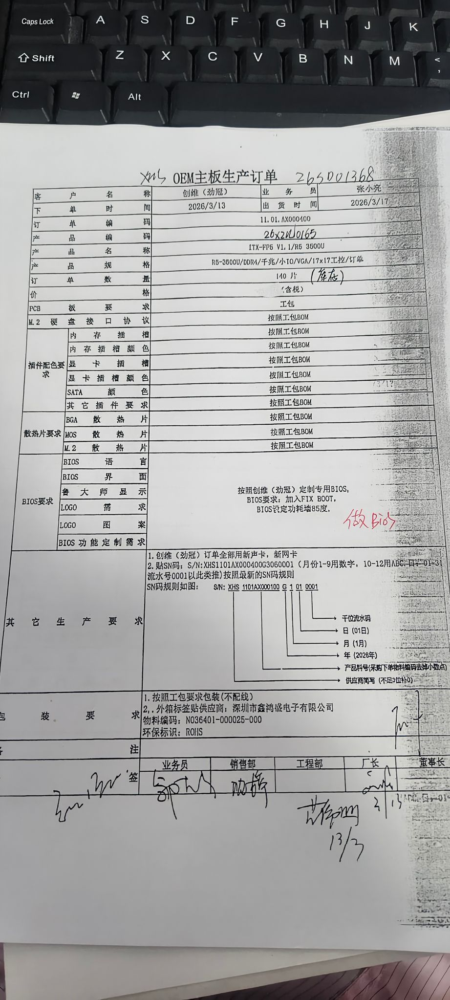

# AMD-ITX-FP5

## 目标

- AMD 平台 ITX 主板 BIOS 开发

## 背景

- AMD 平台 ITX 主板
- FP5 封装

## 发布记录

### 2026-03-18: JF5FBEF1 ✅

| 项目 | 内容 |
|---|---|
| M/B | ITX-FP5 |
| BIOS Version | JF5FBEF1 |
| Release Date | 2026/03/18 |
| Modify | 添加 FixedBootOrder 模块 |
| 状态 | 已完成 |

**功能说明**:
- BIOS Setup 中新增 Fixed Boot Order 设置页面
- 支持 #1 ~ #6 启动顺序调整
- 支持设备类型: USB、Network、Hard Drive、CD/DVD 等

**需求图片**:

---

## 范围

- 做什么
- 不做什么

## 里程碑

- [x] 2026-03-18: 首版发布 (JF5FBEF1)

## 风险

- 

## 相关链接

- 
